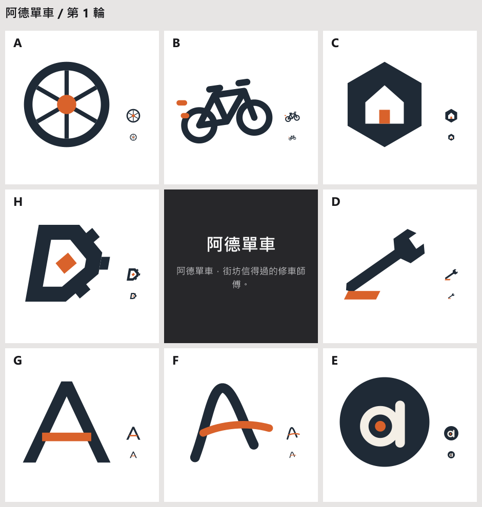

# logo-design

[正體中文](README.md)

logo-design is a Claude Code plugin for designing logo marks. Give it one sentence and Claude draws a 3 x 3 board right away: the brief in the center and eight logo directions around it. Tap one, it moves to the center and eight finer variations grow around it; after a few rounds the direction settles, and only then does Claude build the construction grid, small sizes and delivery files.



The board above is the skill's own round 1 for the single sentence "Ade Cycles, the neighborhood repair shop people trust".

## Use

```text
Design a logo: Ade Cycles, the neighborhood repair shop people trust
```

- The first reply is the board. Claude asks nothing first, except the brand name when it is missing.
- Answer each round with a letter ("B"), two letters to mix them ("B D"), and optionally a sentence ("B, rounder").
- Say "this is the one" when it is. Claude then builds the construction grid, redraws 16 and 32 px, makes one-color and inverse versions, and exports the files.
- Give a photo with the brief ("turn this photo into a mark: ~/Pictures/cat.jpg") and Claude measures its features and colors first, without questions.

## Where the eight directions come from

Round 1 uses three pairs that people tell apart at a glance; two sides of three pairs give exactly eight cells:

| Pair | Research |
| --- | --- |
| Round or angular | Jiang et al. 2016; Bar and Neta 2006 |
| Static or dynamic | Cian et al. 2014; Luffarelli et al. 2019 |
| Figurative or letter | Luffarelli, Mudra and Mahmood 2019; Henderson and Cote 1998 |

From round 2 on, your pick sits in the center and each cell changes one finer attribute (container, mark type, weight), with one deliberate wildcard so the search does not narrow too early. Seeing several designs at once beats refining one at a time (Dow et al. 2010), and moving the pick to the center resembles Picbreeder's branching. No study shows these three pairs cover every difference, so they are a default, not a law. Sources and their verification status are in [evidence.md](skills/designing-logos/references/evidence.md).

## One design document

Each project has one working file, `design.html`: every round, every pick and the final, readable in any browser, including on a phone.

- When Claude Code can publish Artifact pages (desktop or CLI, Pro plan or above, signed in with a claude.ai account), round 1 asks once whether to open the document as a page; later rounds update the same link.
- On the page, tap cells, press "Copy for Claude" and paste the line into the chat. The page cannot send clicks to Claude, so this step is needed; typing the letter in the chat works too.
- After the final, delivery files sit next to `design.html` in `export/`: color, one-color and inverse SVG, PNG from 16 to 1024 px, favicon.ico, a construction sheet, a presentation sheet and a README listing each file's use.

## Install

```bash
claude plugin marketplace add tedliou/logo-design
```

```bash
claude plugin install logo-design@logo-design
```

The scripts need Node.js 20 or later and [sharp](https://sharp.pixelplumbing.com/) for rendering and reading photos. `claude plugin install` installs sharp from `package.json` along with the plugin (tested with Claude Code 2.1.309). If the plugin folder has no `node_modules`, install it by hand:

```bash
cd ~/.claude/plugins/cache/logo-design/logo-design/0.2.0 && npm install
```

Design documents live in `~/logo-work/<name>/`; set `LOGO_WORK_ROOT` to move them.

## Components

| Component | What it does |
| --- | --- |
| `designing-logos` skill | Nine-grid rounds, photo measurement and color sampling, construction checks, the delivery package |
| `designing-pixel-logos` skill | Marks drawn entirely as pixel art, and pixel-by-pixel 16 and 32 px versions of a vector mark |
| `logo-critic` subagent | Looks at round 1 before you do and flags cells that are the same idea or unreadable at 16 px; it never sees the designer's reasons |

## Limits

- Claude does not use an image generation model. Every cell is SVG written by Claude; PNG and favicon.ico are rendered from it. The presentation sheet's paper fibers, misregistration and grain are SVG filters, not photographic print texture.
- The similar-mark check is a web search, not a legal trademark search. Before registering, search the WIPO Global Brand Database and your national office yourself.
- Taste stays with you. The reviewer and the check scripts only remove clear failures.

## For developers: evals

End-to-end cases and how to run them: [skills/designing-logos/evals/README.md](skills/designing-logos/evals/README.md). `evals/` holds cases for `claude plugin eval`: E3 checks which skill each of three requests loads, E4 checks that one sentence in gives a board as the first reply.

```bash
claude plugin eval . --ablation none --runs 1 --allow-tools Bash
```

E4 runs Node scripts, and `claude plugin eval` runs a shell only where it can sandbox it, currently Linux and macOS. On Windows, use `node skills/designing-logos/evals/run.mjs E4 --group skill`.

## License

MIT
