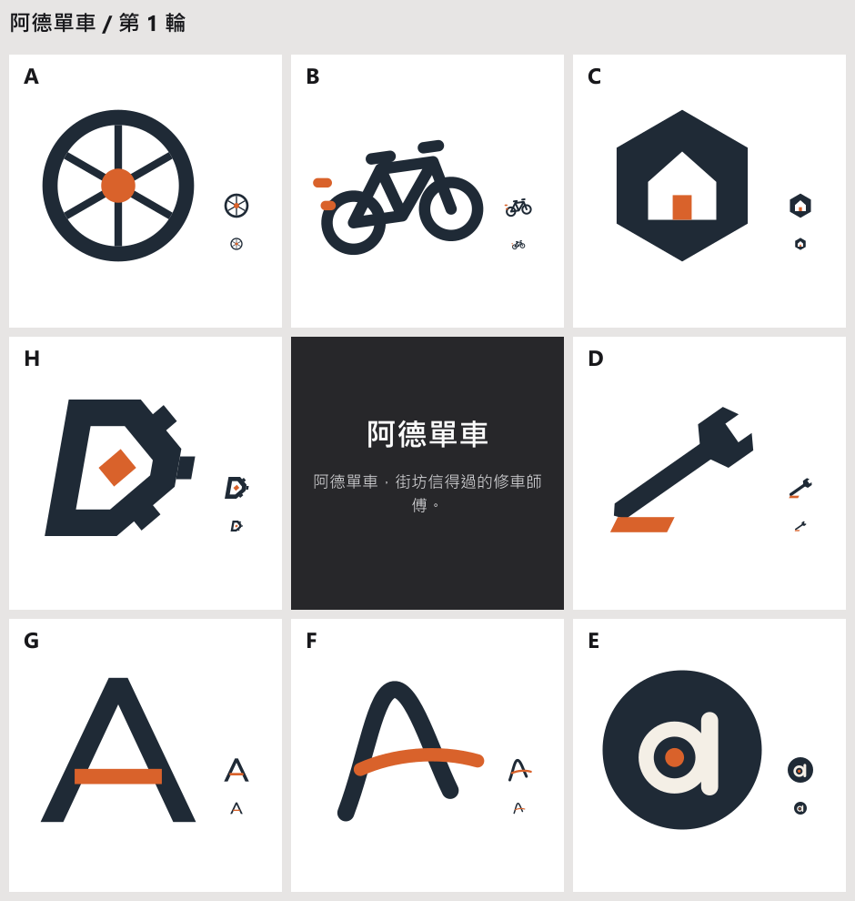

# logo-design

[English](README.en.md)

logo-design 是 Claude Code 的標誌設計 plugin。你給一句話，Claude 直接畫出九宮格：中央是設計案，外圈是八個不同方向的標誌。你點一格，那格移到中央，外圈再長出八個更細的變化，幾輪後收斂到你要的方向，才開始做構成網格、小尺寸與交付檔。



上圖是 skill 實際產出的第 1 輪，輸入只有一句「阿德單車，街坊信得過的修車師傅」。

## 怎麼用

```text
幫我設計一個 logo：阿德單車，街坊信得過的修車師傅
```

- 第一個回應就是九宮格，之前不問問題。只有缺品牌名稱時才會問。
- 每輪只要回一個字母，例如「B」；回兩個字母表示混合，例如「B D」；想補充就加一句，例如「B，再圓一點」。
- 覺得對了就說「就是它」。Claude 接著做構成網格、16 與 32 px 重畫、單色與反白，再輸出交付檔。
- 有照片時一起給，例如「把這張照片變成標誌：~/Pictures/cat.jpg」。Claude 會先量測照片的特徵與顏色，不會問你。

## 每一輪畫什麼

| 輪次 | 外圈八格 |
| --- | --- |
| 第 1 輪 | 八句概念，各自把兩到三個意象揉成一個形，例如「打哈欠的嘴就是一團火」。有照片時，每格都用到照片最明顯的特徵 |
| 第 2 輪 | 你選的概念用八種手法重畫：剪影、骨架、動勢、圖地、減法、融合、替換、切割 |
| 第 3 輪起 | 一次只換一個細節，例如框、粗細、強調色的位置 |

從第 2 輪起，每輪保留一格刻意不同的方向，避免太早收窄。第 1 輪的八格還要分散在三組一般人一眼分得出的對比上：圓或角（Jiang 等 2016）、穩或動（Cian 等 2014）、具象或字母（Luffarelli、Mudra 與 Mahmood 2019）。一次攤開多個方案的效果比逐個修改好（Dow 等 2010），「選中的移到中央再展開」和 Picbreeder 的分支機制相近。出處與查證狀態見 [evidence.md](skills/designing-logos/references/evidence.md)。

skill 會以 xhigh effort 執行。以一張照片加一段簡報實測，三輪加定稿約一小時、16 美元左右（Opus 5.5）。

## 一份設計文件

每個專案只有一個工作檔 `design.html`：所有輪次、你的選擇與定稿都在裡面，用瀏覽器打開就能看，手機也可以。

- Claude Code 能發 Artifact 頁面時（桌面版或 CLI，Pro 以上方案、用 claude.ai 帳號登入），第 1 輪會問你一次要不要開成頁面，之後每輪都更新同一個網址。
- 頁面上點格子、按「複製給 Claude」，再貼回對話。頁面沒辦法直接把點擊傳給 Claude，所以要多這一步；直接在對話打字母也可以。
- 定稿後，交付檔放在 `design.html` 旁邊的 `export/`：彩色、單色與反白 SVG，16 到 1024 px 的 PNG，favicon.ico，構成圖，展示稿，以及列出每個檔案用途的 README。

## 安裝

```bash
claude plugin marketplace add tedliou/logo-design
```

```bash
claude plugin install logo-design@logo-design
```

腳本需要 Node.js 20 以上，算圖與讀照片用 [sharp](https://sharp.pixelplumbing.com/)。`claude plugin install` 會依 `package.json` 一併裝好 sharp（Claude Code 2.1.309 實測）。如果 plugin 資料夾裡沒有 `node_modules`，再手動安裝一次：

```bash
cd ~/.claude/plugins/cache/logo-design/logo-design/0.2.0 && npm install
```

設計文件預設放在 `~/logo-work/<名稱>/`，用環境變數 `LOGO_WORK_ROOT` 改位置。

## 包含的元件

| 元件 | 做什麼 |
| --- | --- |
| `designing-logos` skill | 九宮格選方向、照片量測與取色、構成檢查、交付包 |
| `designing-pixel-logos` skill | 整體像素風的標誌，以及向量標誌在 16、32 px 逐格排出的版本 |
| `logo-critic` 子代理 | 在第 1 輪給你看之前先看過九宮格，指出看起來是同一個點子或 16 px 看不清的格子。它看不到設計理由 |

## 限制

- Claude 不用影像生成模型畫圖。每一格都是 Claude 寫的 SVG，PNG 與 favicon.ico 由 SVG 輸出。展示稿的紙纖維、套色錯位與顆粒用 SVG 濾鏡模擬，比不上攝影。
- 相似商標檢查只是網頁搜尋，不等同法律上的商標檢索。要註冊時，請自己到 WIPO Global Brand Database 與各國商標局查詢。
- 美感由你決定。評審子代理與檢查腳本只刪掉明顯不合格的格子。

## 開發者：評測

完整流程的評測案例與做法見 [skills/designing-logos/evals/README.md](skills/designing-logos/evals/README.md)。`evals/` 放的是給 `claude plugin eval` 用的題目：E3 檢查三種請求分別觸發哪個 skill，E4 檢查只給一句話時，第一個回應就是九宮格。

```bash
claude plugin eval . --ablation none --runs 1 --allow-tools Bash
```

E4 要執行 Node 腳本，`claude plugin eval` 只在能把 shell 關進沙箱的環境才會執行，目前是 Linux 與 macOS。Windows 上改用 `node skills/designing-logos/evals/run.mjs E4 --group skill`。

## 授權

MIT
